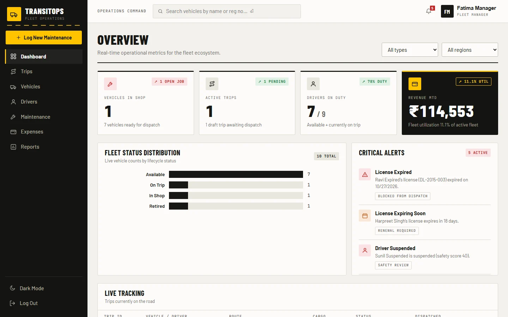
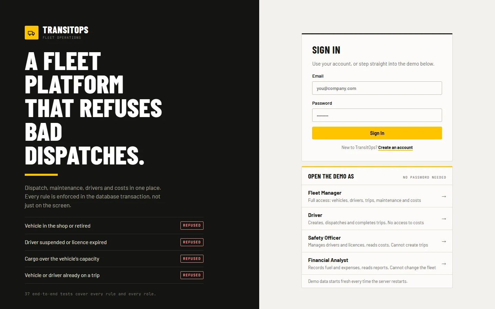
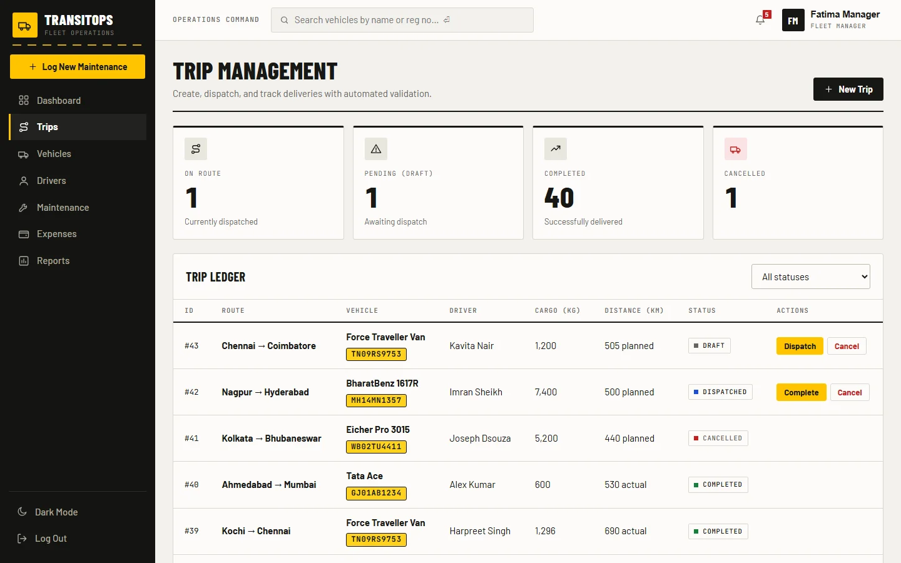
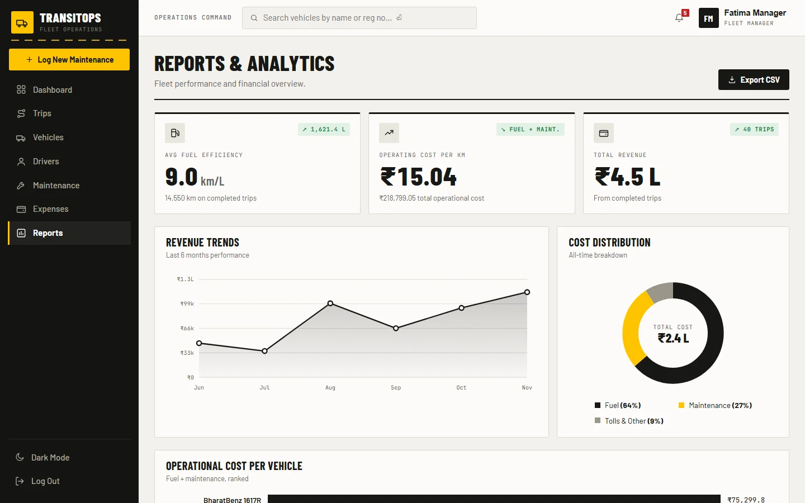
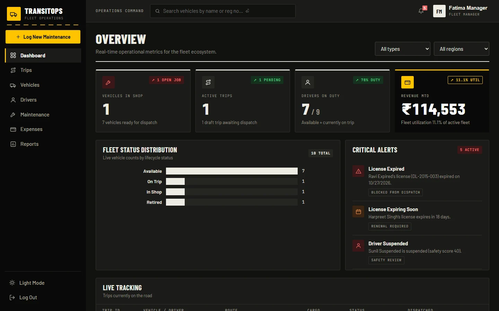

<div align="center">
  <h1>TransitOps</h1>
  <p><strong>A fleet operations platform that refuses bad dispatches.</strong></p>
  <p>
    <a href="https://github.com/Gangadhar017/TransitOps/actions/workflows/ci.yml"></a>
    
    
    
    
    
  </p>
  <h3><a href="https://transitops-1xru.onrender.com">Live demo: transitops-1xru.onrender.com</a></h3>
  <p><em>Pick a role on the sign-in page; no password needed. Free hosting: the first load after an idle spell takes about a minute.</em></p>
</div>



---

**TransitOps** handles dispatch, maintenance, drivers and costs for a transport fleet. It was built for the Odoo Hackathon.

Its point is that the rules are enforced where they cannot be skipped: inside the database transaction. A vehicle in the workshop, a driver with an expired licence, cargo over capacity, a truck that is already on the road: each of these is refused, with a message that says why.

| Sign in | Trips | Reports |
|---|---|---|
|  |  |  |

## Run it

You need Node.js 20 or newer. Nothing else: no database to install, no `.env` to write.

```bash
cd frontend && npm ci && npm run build
cd ../backend && npm ci && npm start
```

Open http://localhost:5000 and pick a role.

With no database configured, TransitOps starts its own PostgreSQL from the binaries in the [`embedded-postgres`](https://www.npmjs.com/package/embedded-postgres) package. It is the real engine, with the same enums, constraints and transactions, running in a temporary folder. It is rebuilt from the seed data on every start.

To use your own PostgreSQL instead, copy `backend/.env.example` to `backend/.env` and set `DATABASE_URL`. Migrations and the seed run at start either way.

### Develop

```bash
cd backend && npm run dev      # API on :5000, restarts on change
cd frontend && npm run dev     # UI on :5173, proxies /api to :5000
```

### Test

```bash
cd backend && npm test
```

This starts the app on the built-in database, runs **37 end-to-end checks** against the real HTTP API and shuts everything down. It covers every business rule, every validation and the whole role matrix. The same command runs in CI on every push.

To run the checks against a server that is already up: `npm run test:e2e` (set `API_URL` to point somewhere other than `http://localhost:5000/api`).

## Rules that are enforced, not suggested

| Rule | Where it is enforced |
|---|---|
| Registration numbers are unique | PostgreSQL `UNIQUE` constraint, returned as a clean 409 |
| Retired and in-shop vehicles cannot be dispatched | Filtered out of the dispatch pool, and checked again inside the dispatch transaction |
| Drivers who are suspended, off duty or hold an expired licence cannot be assigned | Trip service, when the trip is created **and** when it is dispatched |
| A vehicle or driver already on a trip cannot take another | Status check inside the transaction, so two requests cannot both win |
| Cargo cannot exceed the vehicle's capacity | Validation with a message naming both numbers |
| Dispatch, complete and cancel change trip, vehicle and driver together | One atomic `prisma.$transaction` |
| Opening maintenance puts the vehicle in the shop; closing it brings the vehicle back | Maintenance transaction |

## Roles

Every role is enforced twice: `authorize()` middleware on the API, and a role-aware interface.

| Role | Can do | Demo email |
|---|---|---|
| Fleet Manager | Everything: vehicles, drivers, trips, maintenance and costs | `manager@transitops.com` |
| Driver | Create, dispatch and complete trips. No access to costs | `driver@transitops.com` |
| Safety Officer | Manage drivers and licences, read costs. Cannot create trips | `safety@transitops.com` |
| Financial Analyst | Record fuel and expenses, read reports. Cannot change the fleet | `analyst@transitops.com` |

On the demo, the sign-in page enters any of these with one click. That switch (`DEMO_MODE`) is on only when the app runs on the built-in database. The seeded accounts also accept the password `Password@123`.

The seed data includes the awkward cases on purpose: a driver with an expired licence, a suspended driver, a vehicle in the workshop and a retired one. Try dispatching them. It also includes a second fleet with six months of trips, fuel, tolls and workshop visits, so the dashboard and reports have something to show.

## What it is built with

- **Frontend:** React 18 with Vite. No UI kit and no chart library: the line chart, donut and bars are hand-written SVG.
- **Backend:** Node.js and Express, one route module per resource, business rules in `services/`.
- **Database:** PostgreSQL through Prisma. Money and weights are `DECIMAL`, statuses are native enums, uniqueness is a database constraint.
- **Auth:** stateless JWT sessions, bcrypt password hashes.
- **Delivery:** one Render web service. Express serves the API and the built React app from the same origin. CI on GitHub Actions.

```
backend/
  prisma/schema.prisma          8 entities, enums and constraints
  prisma/seed.js                test fixtures plus a demo fleet with six months of history
  src/server.js                 finds or starts a database, migrates, seeds, serves
  src/db/embedded.js            the built-in PostgreSQL
  src/middleware/auth.js        JWT and authorize(...roles)
  src/services/trip.service.js  every dispatch rule, inside transactions
  src/routes/                   one module per resource
  tests/e2e.mjs                 37 rule and role checks
  tests/run.js                  starts the app, runs the checks, stops it
frontend/
  src/components/               layout, icons, hand-written charts, pagination
  src/pages/                    Dashboard, Trips, Vehicles, Drivers, Maintenance, Expenses, Reports
```

## Deployment

[`render.yaml`](./render.yaml) describes the whole deployment: **one free web service and no database**.

An earlier version used Render's free PostgreSQL, which is deleted after 30 days and took the demo down with it. The service now carries its own database, so there is nothing left to expire. The trade-off is deliberate: data lives in the service's temporary disk and is rebuilt from the seed at every start, which is what a public demo wants anyway.

In Render: **New > Blueprint**, select this repository, **Apply**. Every push to `main` redeploys.

## Design notes

The architecture, the entity-relationship diagram, the API, the state machines and the full role matrix are in the [system design document](./SYSTEM_DESIGN.md).

The interface is styled after road signage: asphalt chrome, signal-yellow actions, condensed lettering, and registration numbers set as number plates. Light and dark themes share one stylesheet.


